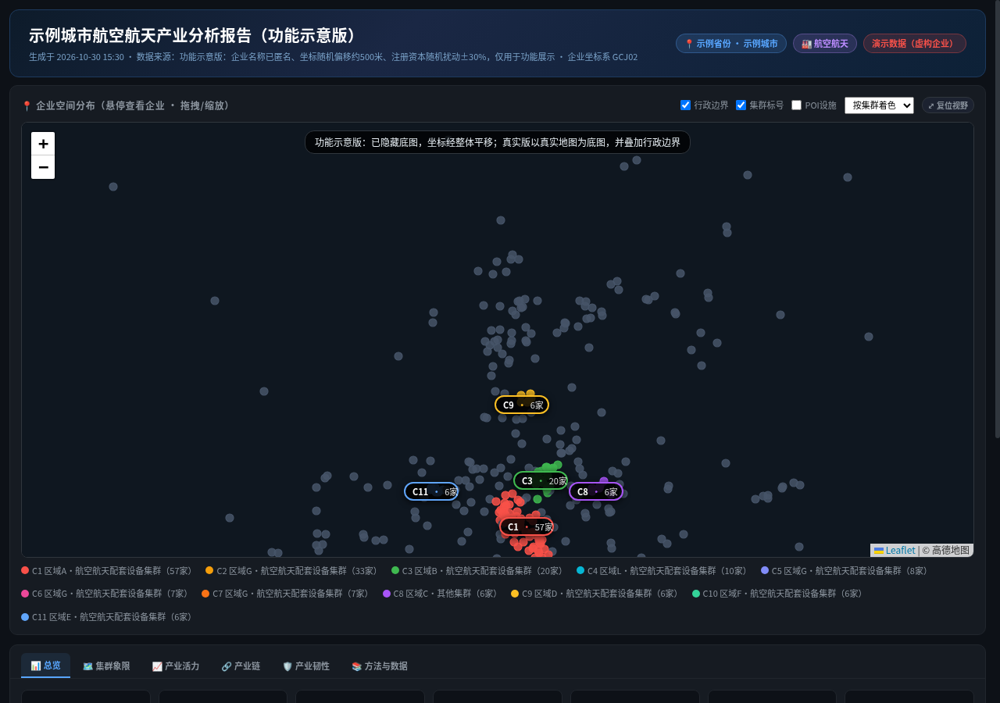

# industry-analysis

产业智能分析 HTML 报告生成 Skill：产业地图、集群识别与象限评估、产业活力、LQ 专门化、产业链诊断、选址适宜性、产业韧性，输出可交互的独立 HTML 报告。使用说明见 [SKILL.md](SKILL.md)。

## 报告效果预览

> 截图来自功能示意版：企业为虚构名称，坐标已整体平移，底图已隐藏。真实报告使用真实地图底图并叠加行政边界。
